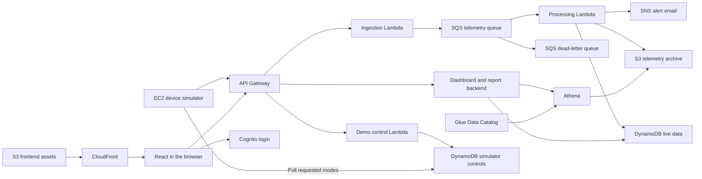

# Product Requirements Document

## Cloud-Based Industrial Equipment Monitoring and Fault Detection

**Status:** Completed — original project scope (archived)

**Archived:** 27 October 2026. This document records the completed original scope and is retained for historical reference. The expanded scope, including predictive maintenance, automatic recovery and additional device types, is under discussion and has not yet been finalized.

**Date:** 14 October 2026  
**Context:** Academic Cloud Computing course project  
**Budget ceiling:** USD $50 of total AWS service usage, before credit offsets  
**Deployment window:** Keep online until the user requests shutdown; no scheduled teardown date  
**Deployment region:** Asia Pacific (Sydney), `ap-southeast-2`. The user approved this change on 14 October 2026 after confirming the account's managed project restrictions block Mumbai.

## 1. Project overview

Build an end-to-end AWS platform that receives telemetry from simulated industrial equipment, processes readings, maintains device state, preserves historical records, detects faults, sends alerts, and displays results in an interactive React dashboard.

There is no physical hardware requirement. One software simulator will represent a factory gateway connected to three motors. All three motors start and normally remain healthy. An operator deliberately triggers faults from the dashboard to demonstrate equipment alerts and device outages. The platform must also demonstrate processing failures, historical analysis, and recovery.

This is a working academic demonstration with a limited operating period. It is not intended to provide production industrial monitoring or safety-critical decisions.

The AWS layer and React dashboard are deployed in Sydney: the EC2 simulator, telemetry pipeline, protected application/control/user-management APIs, fault detection and notifications, reporting, monitoring, and private frontend hosting. CloudFront serves the React application with Cognito sign-in, shared motor monitoring/charts/controls, alerts, historical report visualization and user management. Deployed evidence and acceptance results are recorded in `docs/AWS_ACCEPTANCE.md`. The scope below describes the completed original implementation; it does not define the upcoming expansion.

## 2. Goals and success criteria

- Demonstrate a complete path from simulated telemetry to cloud processing, storage, alerts, and visualization.
- Give each AWS service a clear responsibility within the application.
- Apply the main concepts from approximately 60–80% of the 17-module AWS Academy Cloud Architecting course through practical demonstrations.
- Provide a usable dashboard with login, live device monitoring, recent charts, alerts, and historical reports.
- Demonstrate buffering, duplicate handling, failure isolation, and a limited recovery procedure.
- Provision the infrastructure reproducibly using CloudFormation and the AWS CLI.
- Keep spending within the agreed budget and keep the project online until the user requests shutdown. Resolve the budget-limit behaviour before unattended operation; the original $50 ceiling remains in force unless changed by the user.

Success means that the acceptance scenarios in section 12 can be demonstrated and supported by logs, screenshots, query results, or a short recording.

## 3. Confirmed constraints

Implementation update, 14 October 2026: deploy the original architecture and features in Sydney. The account remains on the Free Plan; no paid-plan upgrade or advanced-feature activation is authorized. Mumbai results below are historical planning checks, not deployment guarantees. Sydney EC2 launch authorization passed a dry-run; required service reads and CloudFormation validation passed. Budget notifications are requested at $20, $30, and $40 before credits, with user approval required before stopping resources. Equipment and operational SNS subscription recipient: `collegeproject@akshaykripalani.com`; email delivery remains pending until confirmation.

Read-only AWS CLI checks performed on 14 October 2026 confirmed:

| Item | Observed result |
| --- | --- |
| Account plan | Free Plan, active |
| Remaining credits | USD $100 |
| Free Plan expiry | 16 March 2027 |
| CLI default region | `ap-south-1` |
| Kinesis Data Streams | Read access denied by a service control policy |
| Amazon Data Firehose | Read access denied by a service control policy |
| QuickSight / Quick Sight | Read access denied by a service control policy |

Kinesis, Firehose, and QuickSight are excluded from this design. The project does not depend on changing the account plan or removing those restrictions.

Access to the other services, resource creation, IAM role creation/passing, and relevant quotas still needs checking. A successful read operation does not guarantee permission to create or configure a resource.

The AWS account is managed by a teammate. Deployment and operation will use authorized CLI access. Credentials must not be stored in source files, frontend assets, or this document. The EC2 simulator and Lambda functions will use IAM roles.

## 4. Users and primary journeys

### Dashboard user

A project team member or evaluator signs in, views equipment status, opens a device to inspect recent readings, reviews alerts, and requests a historical report. Dashboard users authenticate through Cognito and do not need AWS accounts. The user confirmed that the college has no additional mandatory feature, service, or report-format requirements.

Initial dashboard accounts:

| Email | Roles |
| --- | --- |
| `akshay.kripalani74@nmims.in` | Viewer and operator |
| `collegeproject@akshaykripalani.com` | Viewer and operator |

Both accounts have been created and invited through Cognito, and their viewer/operator groups were verified by live tests. Login account addresses do not automatically establish SNS alert recipients or confirm email subscriptions. The current SNS subscription for collegeproject@akshaykripalani.com was confirmed by the user and verified in AWS; both demonstration fault episodes have SNS acceptance records.

### Project operator

A team member deploys the platform through the CLI, triggers and resets individual motor faults from the dashboard, inspects CloudWatch logs and metrics, demonstrates failures and recovery, and removes the deployed resources.

Motor demo controls and a basic user-management page are part of the dashboard. The user-management page lets an operator add users and assign viewer/operator roles. Infrastructure administration, queue redrive, load-test settings, and processing-interruption exercises can use the CLI; a general infrastructure administration UI is outside the initial scope.

## 5. Proposed architecture



CloudFormation defines the infrastructure. IAM permissions govern access between components. CloudWatch records operational logs and metrics and provides alarms.

### Service responsibilities

| Service | Responsibility |
| --- | --- |
| EC2 | Run a Python simulator representing a factory gateway and its virtual devices. |
| VPC | Provide the simulator's subnet, routing, internet connectivity, and security groups. |
| API Gateway | Expose telemetry ingestion and protected dashboard, report, and simulator-control endpoints. |
| Lambda | Validate ingestion, process queued telemetry, serve application queries, coordinate historical reports, and record authorized simulator-control requests. |
| SQS | Buffer accepted telemetry so ingestion and processing can operate independently. |
| SQS dead-letter queue | Isolate messages that repeatedly fail processing for inspection and redrive. |
| DynamoDB | Store device metadata, latest state, recent readings, alert state/history, and a separate set of requested/applied simulator modes. |
| S3 telemetry archive | Store batches of historical readings for analysis and recovery. |
| Athena | Run on-demand SQL queries over archived telemetry. |
| Glue Data Catalog | Describe archive tables and their layout for Athena; continuous crawlers are not required. |
| SNS | Deliver operational email alerts to confirmed project recipients. |
| S3 frontend assets + CloudFront | Deliver the built React application over HTTPS and cache its assets. |
| Cognito | Maintain dashboard accounts and authenticate users. |
| IAM | Give the simulator, functions, and deployment identity the permissions they need. |
| CloudWatch | Monitor the platform's operational health and support troubleshooting. |
| CloudFormation | Create, update, and reproduce the infrastructure through templates. |

## 6. Storage and frontend decisions

### DynamoDB and S3 serve different access patterns

DynamoDB is the application's working database. The dashboard uses it for questions such as “What is machine 7 doing now?” and “What happened during the last hour?”

S3 is the historical archive. Date-organized files preserve telemetry after the recent-history window expires. Athena uses those files for questions such as “Which machines had the highest temperatures yesterday?”

A reading therefore updates the current device state and contributes to the historical archive. Current state is overwritten by newer readings; archived history is retained. Recent readings may also be retained temporarily in DynamoDB for live charts.

The historical archive and the frontend assets will use separate buckets with separate access policies. Both will use encryption at rest. Telemetry remains private, and application requests use HTTPS.

### React hosting

The React frontend is a browser-rendered single-page application. Its build produces HTML, JavaScript, CSS, and other assets, which are uploaded to S3 and delivered through CloudFront. The browser executes React and calls the backend APIs for changing data.

S3 does not execute backend code. Lambda supplies that runtime. Server-side rendering and a continuously running frontend Node server are outside this scope.

Hosting the same React build on EC2 with Nginx is a valid alternative, but S3 + CloudFront is the proposed default. It separates dashboard delivery from the simulator and provides a practical caching demonstration. The EC2 instance already provides the compute and networking learning exercises.

## 7. Functional requirements

### FR-01: Simulated equipment

- Simulate three motors (`motor-01`, `motor-02`, and `motor-03`) from one EC2 instance.
- Start all motors in normal operation. Do not automatically rotate devices through failure scenarios in the default demonstration.
- Emit one reading per reporting motor every 10 seconds by default; allow rate and device count changes for separate controlled load tests.
- Include `schemaVersion`, `eventId`, `deviceId`, `observedAt`, `temperatureC`, `vibrationMmS`, `powerWatts`, and `operatingState` in each reading.
- Batch transmissions where practical while preserving individual reading identities and timestamps.
- Generate slowly changing, plausible synthetic measurements rather than unrelated random values; allow a fixed seed for repeatable tests.
- Support operator-triggered normal operation, overheating, excessive vibration, and loss of reporting for each motor independently. A fault remains active until reset or changed by the operator.
- Keep stopped-motor, duplicate, invalid-reading, and traffic-burst injections available as development/test scenarios.
- Allow a local simulator during development before deploying it to EC2.

Example reading:

```json
{
  "schemaVersion": 1,
  "eventId": "demo-001:motor-02:42",
  "deviceId": "motor-02",
  "observedAt": "2026-10-14T10:00:00Z",
  "temperatureC": 57.4,
  "vibrationMmS": 1.8,
  "powerWatts": 420,
  "operatingState": "running"
}
```

The event ID combines a simulator run identifier, device identifier, and sample number and stays stable across transmission retries. The backend records receipt time separately. Scenario labels belong in simulator-control/test metadata, not in the measurement payload as a precomputed anomaly result.

### FR-02: Ingestion

- Authenticate the simulator using its IAM role and signed API requests.
- Validate required fields, registered device identity, timestamps, and measurement types.
- Reject invalid requests with an understandable response.
- Return an accepted response only after valid telemetry has been successfully placed on SQS. Acceptance means queued, not fully processed.
- Support retries using stable event IDs.

### FR-03: Queued processing

- Use a Lambda event source mapping to process SQS messages in batches.
- Update device state, store recent readings, archive telemetry, and evaluate alert rules.
- Use event IDs to prevent duplicate readings and unnecessary repeat notifications.
- Prevent an older event from replacing newer device state.
- Retry failed work and isolate repeatedly failing messages in the dead-letter queue.
- Avoid retrying successful messages unnecessarily when part of a batch fails.
- Acknowledge processing success only when required storage operations have completed.

Writes to DynamoDB, S3, and SNS are not one atomic transaction. Implementation must account for partial failures through retry-safe operations. The project does not claim exactly-once processing or exactly-once email delivery.

### FR-04: Device state and retention

- Maintain metadata, thresholds set through project configuration, latest readings, and the last-seen timestamp for each device. Dashboard editing of thresholds is outside the initial scope.
- Determine online/offline status from the last received valid telemetry timestamp.
- Use a configurable offline threshold; the default is 60 seconds for the short demonstration.
- Distinguish a stopped motor that continues reporting from an offline device that sends no telemetry.
- Keep 24 hours of recent readings in DynamoDB for live charts.
- Keep historical telemetry in S3 for 30 days. Configure retention for old object versions as well so versioning does not retain history indefinitely. Export any required long-term evidence separately.
- Document how accepted but unprocessed messages, dead-letter messages, and archived readings are reconciled during a demonstration.

### FR-05: Fault detection and alerts

- Detect configured temperature and vibration threshold breaches.
- Require three consecutive readings above a fault threshold before activating an alert.
- Record alerts with device ID, rule, relevant reading, event time, and alert state.
- Send one SNS email when a fault becomes active. Do not repeat emails while the same fault remains active. A new fault episode may send a new email after the previous episode resolves.
- Allow the user to confirm SNS email subscriptions later. Until confirmation, dashboard alerts must still work and email delivery must be shown as pending, not falsely reported as successful.
- Require three consecutive healthy readings to resolve a fault. Keep the resolved alert in history; Reset does not delete it. Do not send recovery emails in the initial version.
- Display device outages on the dashboard. Separate email alerts for outages are optional.

Fault detection will use deterministic rules. Machine learning anomaly detection is outside the initial scope.

### FR-06: Interactive dashboard

Build a custom React dashboard with:

- **Overview:** online/offline counts, current readings, active alerts, and data freshness.
- **Device detail:** metadata and recent temperature, vibration, and power charts.
- **Alerts:** active and historical alerts, filterable by device and time.
- **Historical reports:** date/device selection, report status, and returned charts or tables.
- **Demo controls:** per-motor fault buttons, requested/applied mode, and a reset-all action for operators.
- **Users:** an operator-only page for adding login accounts and assigning viewer/operator roles.
- **Application states:** loading, empty results, API failures, expired sessions, and stale telemetry.

Use a charting library for graph rendering. Refresh live views every 10 seconds while the relevant page is open. This is polling-based near-real-time monitoring; WebSockets are outside the initial scope.

### FR-07: Login and API protection

- Create a Cognito user pool and browser application client.
- Use Cognito-hosted login, with the available login experience chosen to fit account access and budget.
- Use an authorization-code flow with PKCE and no browser client secret.
- Redirect users back to React after login; obtain tokens and attach the access token to protected API requests.
- Configure API Gateway JWT authorization and suitable scopes on dashboard/report routes.
- Reject protected requests without valid authentication, even if the caller bypasses the React login screen.
- Support sign-out and session expiry handling.
- Keep ingestion authentication separate from dashboard login: the simulator uses IAM; people use Cognito.

A small set of evaluator/team accounts is sufficient. Provide viewer and operator roles. Users may have either or both roles; both initial accounts must have both. Operators can control the simulator and add users/assign roles; viewers can read telemetry and reports. Enforce control and user-management permissions in the backend, not just by hiding buttons. Public registration, social login, and elaborate user roles are outside the initial scope.

### FR-08: Historical analysis

- Archive readings in batches organized by date, with a schema described in Glue Data Catalog.
- Implement three predefined Athena reports: daily average/maximum temperature, vibration threshold-breach counts, and average power while running, grouped by motor and date. Count breached readings separately from distinct alert episodes.
- Expose report creation, status, and result retrieval through authenticated backend endpoints.
- Let React show report progress and visualize completed results.
- Restrict reports to supported parameters and a bounded date range; do not expose unrestricted SQL execution from the browser.
- Use Athena on-demand SQL, with scan limits, rather than reserved capacity or Spark sessions.
- Keep live refreshes on DynamoDB-backed APIs, not repeated Athena scans.

### FR-09: Monitoring

- Capture useful ingestion, processing, and query-backend logs without logging credentials or full payloads for every normal reading.
- Monitor Lambda errors/throttling and SQS backlog age/dead-letter messages.
- Configure a small set of operational alarms, with SNS notifications where appropriate.
- Retain logs for a bounded period and provide evidence from a deliberate failure demonstration.

CloudWatch monitors the platform. Equipment fault rules run in the telemetry processor; the React dashboard displays their results.

### FR-10: Deployment and recovery

- Describe infrastructure in CloudFormation templates and deploy through the AWS CLI.
- Separate infrastructure deployment from building and uploading frontend assets.
- Configure the EC2 simulator's VPC, subnet, routing, and security group deliberately.
- Keep the simulator small, with controlled network access and no NAT gateway requirement in the proposed topology.
- Enable S3 versioning on the telemetry archive and demonstrate recovering an overwritten/deleted test object.
- Recreate a separate test device-state table and rebuild its state from archived telemetry.
- Preserve original event times during replay and suppress demonstration replay notifications.
- Measure the recovery exercise and describe its limits: it does not prove recovery from an entire AWS Region failure.

### FR-11: Dashboard-controlled simulator faults

- Provide **Overheat**, **Vibration fault**, **Disconnect**, and **Reset to normal** controls for each motor, plus **Reset all motors**.
- All users share the same three motors. An operator's changes are visible to every signed-in user; there are no separate simulator sessions per user.
- A control applies only to the selected motor; other motors continue their current behaviour.
- Allow one requested scenario per motor at a time for the initial implementation.
- Different motors may have different faults at the same time. Do not combine overheating and vibration faults on one motor in the initial version.
- An authenticated operator action calls API Gateway and a control Lambda, which writes the requested mode to dedicated DynamoDB control records. These records are separate from measured telemetry/current device state.
- The simulator polls these records independently of telemetry transmission, initially every five seconds, and changes the selected motor's generated behaviour.
- Record the request ID, requesting user, request time, requested mode, and simulator acknowledgement. Display pending, applied, or failed control status in the dashboard.
- Report a command as applied only after the simulator acknowledges it. A stale acknowledgement must not mark a newer request as applied.
- Overheating increases actual generated temperature readings; a vibration fault increases vibration readings. Fault buttons do not insert alerts or directly change the measured health indicator.
- **Disconnect** silences one virtual motor, not the entire simulator process. The control polling loop remains active so the operator can reset that motor remotely.
- **Reset to normal** returns measurements toward their normal range or resumes reporting. Equipment alerts resolve through the ordinary telemetry-processing rules rather than being deleted by the button.
- Recover temperature and vibration gradually, with a target of returning readings to normal within about 30 seconds after the simulator applies Reset. Alert resolution then follows the three-healthy-readings rule. Resume disconnected telemetry at the next normal reporting interval.
- Tune fault ramps so the equipment alert can be demonstrated within about one minute under normal load.
- On a new simulator run, initialize all motors to normal and expose the run identifier. Do not accidentally resume stale fault commands from a previous demonstration.
- Keep synthetic fault controls clearly labelled as demonstration features.

## 8. Scope boundaries

The initial scope excludes physical sensors, MQTT/IoT Core integration, Kinesis, Firehose, QuickSight, machine learning, container platforms, relational databases, multiple regions, hybrid networking, production high availability, and automated cross-region disaster recovery.

CLI administration is acceptable. The project does not require a device-management portal, arbitrary analytics queries, or every AWS service mentioned in the course.

## 9. Course coverage

The coverage goal concerns practical application of main concepts, not completion of every lesson or feature. The proposed demonstrations map substantially to 12 of 17 modules (approximately 71%), with partial coverage of two more.

| Module | Proposed evidence | Coverage intent |
| --- | --- | --- |
| 1: Orientation | Project context and business scenario | Supporting context |
| 2: Architecture principles | Service choices, region rationale, and cost/reliability trade-offs | Main concepts |
| 3: Access security | Scoped simulator and function IAM roles | Main concepts |
| 4: Object storage | S3 archive, versioning, retention, and frontend assets | Main concepts |
| 5: Compute | EC2 simulator deployment and operation | Main concepts |
| 6: Databases | DynamoDB data model, queries, and database-choice rationale | Main concepts |
| 7: Networking | Configured VPC, subnet, routes, gateway, and security group | Main concepts |
| 8: Network interconnection | No hybrid links or peering required | Outside scope |
| 9: Application/data security | Cognito, protected APIs, and encryption; limited federation/account-management coverage | Partial |
| 10: Monitoring/scalability/availability | CloudWatch alarms and controlled load tests; no EC2 fleet or load-balancer failover | Partial |
| 11: Automation | CloudFormation deployment and reproducibility | Main concepts |
| 12: Caching | CloudFront asset caching and update/invalidation demonstration | Main concepts |
| 13: Decoupling | Queue backlog, retries, dead-letter isolation, and recovery | Main concepts |
| 14: Serverless applications | Event-driven processing and separate backend functions | Main concepts |
| 15: Data engineering | Collection, processing, archival, SQL analysis, and visualization | Main concepts |
| 16: Recovery planning | Object restore, test-state reconstruction, measured recovery limits | Main concepts |
| 17: Certification preparation | No application feature required | Outside implementation scope |

Course identification is based on the 17-module AWS Academy Cloud Architecting version 3 outline discussed in this chat. Verify that it matches the college's exact syllabus before using coverage percentages in the final submission.

## 10. Workload and budget

The planning workload is three motors, one reading every 10 seconds. The user now requires the project to remain online until shutdown is requested. For a 14-day estimation example, continuous reporting would produce 362,880 readings. Conservatively allowing 1 KiB per reading gives approximately 0.37 GB of raw telemetry before batching overhead and compression; the example message itself is smaller. Simulator control polling adds DynamoDB reads and must be included in the estimate. Live chart retention is shorter than archive retention.

The platform may remain deployed while simulation is paused. Controlled load tests should be brief and bounded.

| Area | Provisional allocation |
| --- | ---: |
| APIs, Lambda, SQS, DynamoDB, alerts, and logs | $15 |
| EC2 simulator, EBS, and public IPv4 | $10 |
| Frontend delivery, archive storage, catalog, and queries | $5 |
| Development/testing contingency | $20 |
| **Total ceiling** | **$50** |

These are spending allocations for the original short demonstration. The implemented conservative Sydney model is $26.93 per 730-hour month before credits and free allowances, including a $5 variable-service allowance; see `docs/budget-model.json` and the captured public rates. This is an estimate, not a guarantee of indefinite hosting within $50. Development usage also counts toward the ceiling. Notify at $20/$30/$40 and ask the user before stopping any resource for spending reasons. Account credits and Free Plan expiry also limit continued operation; the observed expiry is 16 March 2027. An account-plan upgrade is not part of this scope.

Mumbai Athena on-demand SQL is listed at $5 per TB scanned. For illustration, 100 queries each scanning 2.4 GiB would cost approximately $1.17 in Athena query charges, excluding storage, requests, catalog usage, taxes, and credit offsets. Actual scanned bytes depend on file layout and queries. An initial Athena query allowance of $1–3 should be validated against report frequency.

Use batched archive objects, short log retention, a small number of operational metrics, and date-restricted reports. Set budget notifications and application usage limits where available. Budget notifications are alerts, not an automatic hard spending cap.

Keep the deployed project online until the user requests shutdown, subject to an agreed budget-limit rule and account availability. Do not schedule teardown at the end of a demonstration or after 14 days. When shutdown is requested, export required evidence/data before deleting resources. Teardown must include the simulator, storage volumes, frontend distribution, and other billable resources as applicable. Versioned S3 objects and retained resources require explicit cleanup; deleting a stack alone may not remove them.

## 11. Quality and operational requirements

- Under normal load, aim for valid readings to appear on the dashboard within 30 seconds; measure actual latency before claiming this result.
- Show event/last-seen times so users can distinguish fresh readings from stale state.
- Keep API, processing, and archive schemas consistent and document units for every measurement.
- Protect data through backend authorization, scoped service permissions, private storage, and HTTPS.
- Make duplicate handling, processing retries, and out-of-order behavior observable through controlled tests.
- Treat the simulator as a single-instance demonstration workload. Stopping it should show devices becoming stale/offline without implying a failure of the entire backend.
- Bound traffic, query scans, runtime resource sizes, and retention to fit the project budget.

## 12. Acceptance scenarios

| Scenario | Required result |
| --- | --- |
| Normal operation | All three motors start healthy and stay healthy without fault commands; current state and recent charts update, and readings reach the archive. |
| Login | A team/evaluator account signs in and can access protected data. |
| Initial roles and user management | Both specified initial accounts have viewer and operator roles. An operator can add another user and assign roles; a viewer-only account cannot use the management API. |
| Unauthorized API request | A direct request without a valid token is rejected independently of the frontend. |
| Manual equipment fault | Clicking Overheat or Vibration fault changes the selected motor's readings. Ordinary processing then produces stored alerts, dashboard visibility, and confirmed SNS email delivery; other motors remain unaffected. |
| Pending email confirmation | Dashboard alerts work before SNS confirmation. Email delivery is tested after the user confirms the subscription; until then, record this acceptance step as pending. |
| Device outage and reset | Clicking Disconnect silences one motor, which becomes offline after the configured threshold. Reset restores reporting without restarting or accessing the EC2 process. |
| Fault recovery | Resetting an overheated/vibrating motor returns its readings to normal and lets existing alert-resolution rules clear the active condition. Reset all returns every motor to normal. |
| Control acknowledgement | The dashboard distinguishes requested mode from acknowledged simulator mode and does not claim an unapplied command succeeded. |
| Unauthorized control request | A viewer or unauthenticated caller cannot trigger or reset a fault, including through a direct API request. |
| Processing interruption | Ingestion continues queuing while processing is paused; processing catches up after recovery. |
| Duplicate/older event | A duplicate does not add duplicate chart records or unnecessary alerts; an older event does not overwrite newer current state. |
| Invalid input | Invalid ingestion is rejected; repeatedly failing queued test messages are isolated and can be inspected/redriven. |
| Historical report | A supported date/device query produces correct results that React displays as a chart or table; cross-check against known simulator data. |
| Caching | Frontend delivery uses CloudFront caching; a deployed asset update can be made visible deliberately. |
| Recovery | A test archived object is restored and a separate state table is rebuilt from archived records without replaying alert emails. |
| Reproducibility and teardown | CloudFormation deploys a test environment, and documented cleanup removes intended resources. |

## 13. Implementation milestones

1. **Access and cost validation:** Check remaining services and permissions, choose resource sizes and feature plans, prepare a regional estimate, and finalize schemas and thresholds.
2. **Working telemetry pipeline:** Establish CloudFormation templates, IAM roles, local simulation, ingestion, SQS processing, DynamoDB state, S3 archival, and basic logging.
3. **Dashboard and login:** Build React views, Cognito login, protected APIs, live charts, per-motor demo controls with acknowledgements, and S3/CloudFront frontend delivery.
4. **Alerts and reports:** Add fault rules, SNS email, historical report endpoints, Athena tables/queries, and report visualization.
5. **Course demonstrations:** Deploy the EC2 simulator/VPC and demonstrate buffering, failures, caching, monitoring, and limited recovery.
6. **Submission and ongoing operation:** Run acceptance scenarios, record actual spend/latency/recovery results, export evidence, and keep the project online under the agreed budget rule. Provide teardown instructions for a later user-requested shutdown.

## 14. Deliverables

- Application source for the simulator, Lambda backend, and React dashboard.
- CloudFormation templates and CLI deployment/teardown instructions.
- Telemetry schema, device-state model, alert rules, and historical query definitions.
- A working online demonstration that remains available until the user requests shutdown, within the agreed budget/account limits.
- A short report explaining architecture choices, course mapping, actual costs, tests, and limitations.
- Screenshots or recordings of the acceptance scenarios and exported recovery/query evidence.

## 15. Decisions still to validate

- Permissions and quotas for all proposed services, including IAM roles and CloudFormation.
- Exact instance size, simulator networking, Cognito feature plan, and dashboard chart library.
- DynamoDB access patterns; the agreed recent-reading retention is 24 hours.
- Archive schema, file size/batching, date organization, and query limits.
- Exact synthetic normal ranges and fault thresholds, chosen during implementation. Three-reading activation/recovery, one email per fault episode, and dashboard-only outage detection are the agreed defaults.
- Partial-failure/retry behavior across state updates, archive writes, and notifications.
- Exact course-module mapping and final cost estimate. The user confirmed no additional college requirements and no fixed shutdown date.
- Budget behaviour was resolved: notify at $20/$30/$40 before credits, and ask before stopping anything. There is no automatic shutdown authorization or hard cap. Continued operation does not change the $50 ceiling.
- The user accepted the product defaults: shared motors, one fault per motor, gradual recovery toward normal within about 30 seconds, configuration-only thresholds, retained resolved alerts, 24-hour recent charts, and 30-day historical telemetry. These are requirements, not unanswered questions.

## 16. References

Sources were consulted during project planning. Service access and pricing must be rechecked before deployment.

- [AWS service access matrix for the limited-rollout new signup experience](https://docs.aws.amazon.com/accounts/latest/reference/supported-services-sign-up-new.html). This matrix is specific to that signup experience; this project's excluded-service decisions also rely on actual CLI denials.
- [AWS Free Tier plan documentation](https://docs.aws.amazon.com/awsaccountbilling/latest/aboutv2/free-tier-plans.html).
- [AWS serverless single-page application architecture](https://docs.aws.amazon.com/whitepapers/latest/serverless-multi-tier-architectures-api-gateway-lambda/single-page-application.html).
- [Lambda with SQS: batching, retries, and duplicate handling](https://docs.aws.amazon.com/lambda/latest/dg/with-sqs.html).
- [Cognito-hosted authentication](https://docs.aws.amazon.com/cognito/latest/developerguide/cognito-user-pools-managed-login.html).
- [API Gateway JWT authorization](https://docs.aws.amazon.com/apigateway/latest/developerguide/http-api-jwt-authorizer.html).
- [Private S3 origins with CloudFront](https://docs.aws.amazon.com/AmazonCloudFront/latest/DeveloperGuide/private-content-restricting-access-to-s3.html).
- [Athena and Glue Data Catalog](https://docs.aws.amazon.com/athena/latest/ug/data-sources-glue.html).
- [Athena pricing](https://aws.amazon.com/athena/pricing/) and [Mumbai price list](https://pricing.us-east-1.amazonaws.com/offers/v1.0/aws/AmazonAthena/current/ap-south-1/index.json).
- [VPC and public IPv4 pricing](https://aws.amazon.com/vpc/pricing/).
- [CloudWatch overview](https://docs.aws.amazon.com/AmazonCloudWatch/latest/monitoring/WhatIsCloudWatch.html).
- [CloudFormation overview](https://docs.aws.amazon.com/AWSCloudFormation/latest/UserGuide/Welcome.html).
- [AWS-authored Cloud Architecting v3 course outline, public mirror](https://www.scribd.com/document/941592548/AWS-Academy-Cloud-Architecting-Version-3-0-Course-Outline-English).
