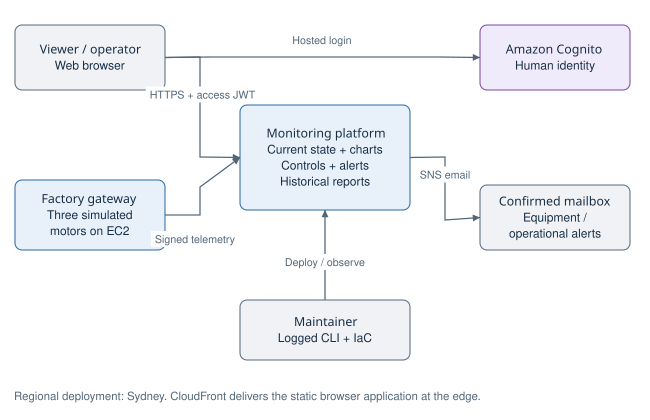
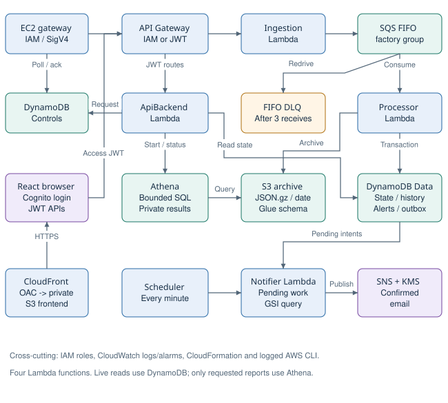
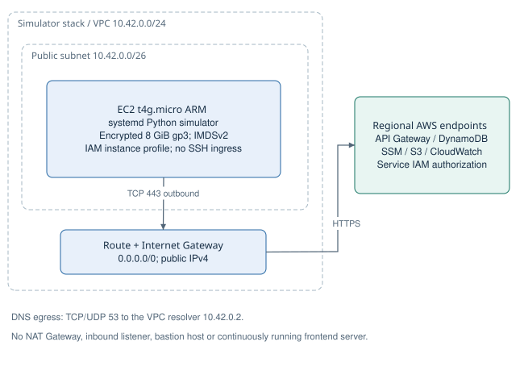
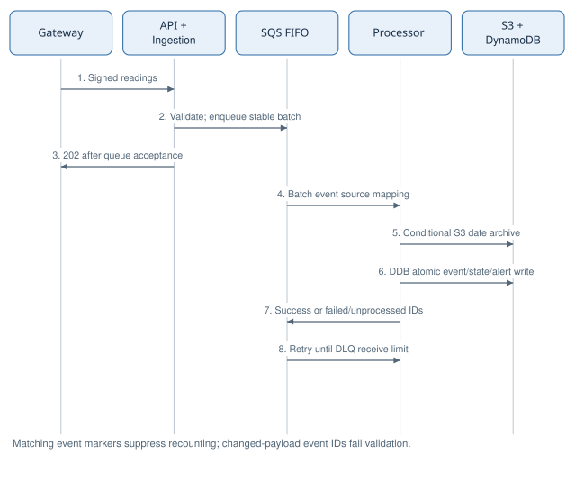
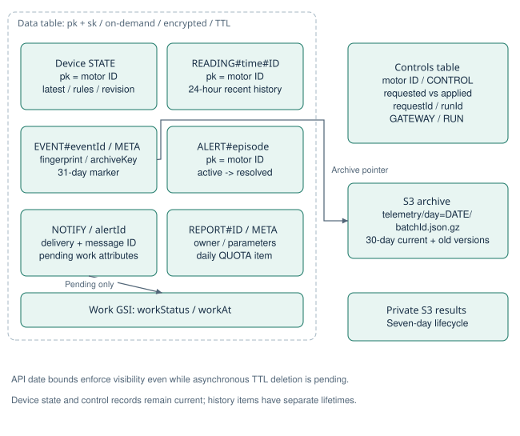
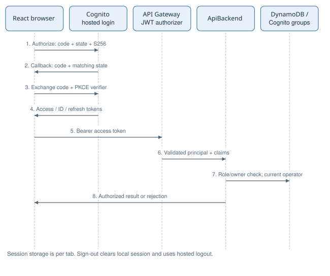
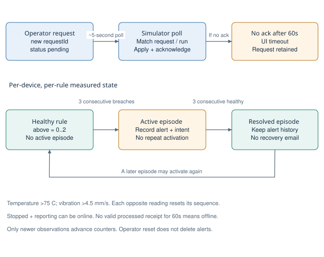
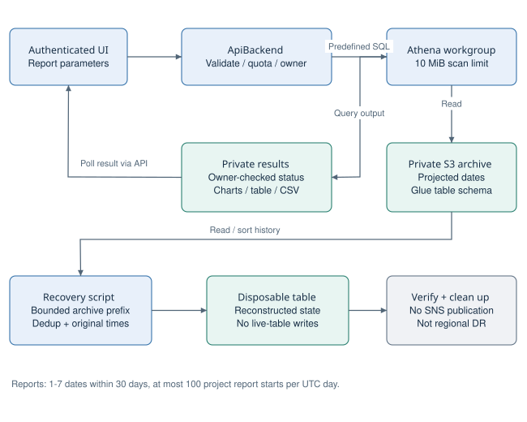
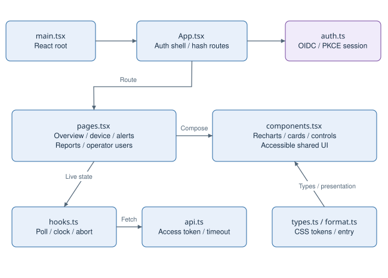
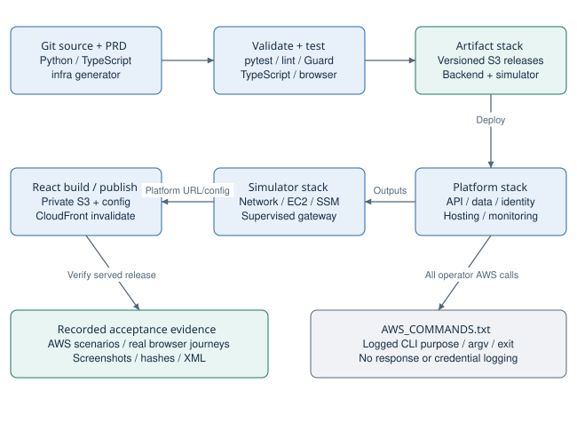

# Part 5. Architecture and design diagrams

All diagrams describe the implemented design. SVG is the vector submission original; PNG is a convenient preview; Mermaid is editable semantic source. The PDF embeds vector drawings. Colors distinguish compute (blue), stores (green), identity (purple), external actors (grey) and exceptional states (amber). Arrows show the labeled request/data/dependency direction; network boundaries are explicit only in Figure 3.

## Figure 1. System context

People authenticate through Cognito; the gateway uses IAM. Equipment notification subscription is separate from a login account.

[PNG](diagrams/01-system-context.png) | [Editable Mermaid](diagrams/01-system-context.mmd)

## Figure 2. Implemented AWS components

Logical data flow, not VPC placement. ApiBackend owns controls and reporting. A durable outbox and scheduled Notifier separate email from telemetry commit.

[PNG](diagrams/02-aws-components.png) | [Editable Mermaid](diagrams/02-aws-components.mmd)

## Figure 3. Network and runtime boundary

Only the simulator occupies the project VPC. Public IPv4 supports outbound HTTPS; its security group has no inbound rules. Lambda is not placed in this VPC.

[PNG](diagrams/03-network-deployment.png) | [Editable Mermaid](diagrams/03-network-deployment.mmd)

## Figure 4. Telemetry commit and retry sequence

A 202 confirms queue acceptance. Processor archives before per-reading transactions. If a message fails, FIFO processing stops and unprocessed IDs are returned for retry.

[PNG](diagrams/04-telemetry-sequence.png) | [Editable Mermaid](diagrams/04-telemetry-sequence.mmd)

## Figure 5. Logical data model and access patterns

These are DynamoDB item types and S3 layouts, not relational tables. pk/sk compose each item key; a sparse index selects pending notification work.

[PNG](diagrams/05-data-model.png) | [Editable Mermaid](diagrams/05-data-model.mmd)

## Figure 6. Browser authentication and authorization

The browser is a public client with no client secret. The access token authorizes application APIs; privileged backend requests also check current Cognito groups.

[PNG](diagrams/06-auth-sequence.png) | [Editable Mermaid](diagrams/06-auth-sequence.mmd)

## Figure 7. Controls and fault state machines

Control acknowledgement and measured fault state are different processes. Reset changes the requested simulator mode; actual healthy readings resolve an alert.

[PNG](diagrams/07-control-fault-state.png) | [Editable Mermaid](diagrams/07-control-fault-state.mmd)

## Figure 8. Historical reports and limited recovery

Reporting and reconstruction reuse private history for different purposes. Reconstruction targets a disposable table and never republishes old fault emails.

[PNG](diagrams/08-reports-recovery.png) | [Editable Mermaid](diagrams/08-reports-recovery.mmd)

## Figure 9. Frontend software structure

The browser serves five role-aware views. Shared polling and authentication feed a single protected API client; charts and UI state are derived from API responses.

[PNG](diagrams/09-frontend-structure.png) | [Editable Mermaid](diagrams/09-frontend-structure.mmd)

## Figure 10. Build, deployment and evidence lifecycle

Infrastructure and static UI have independent release steps. Operator AWS calls use the append-only logger; the document build is an offline authoring step, not another deployment.

[PNG](diagrams/10-deployment-lifecycle.png) | [Editable Mermaid](diagrams/10-deployment-lifecycle.mmd)
