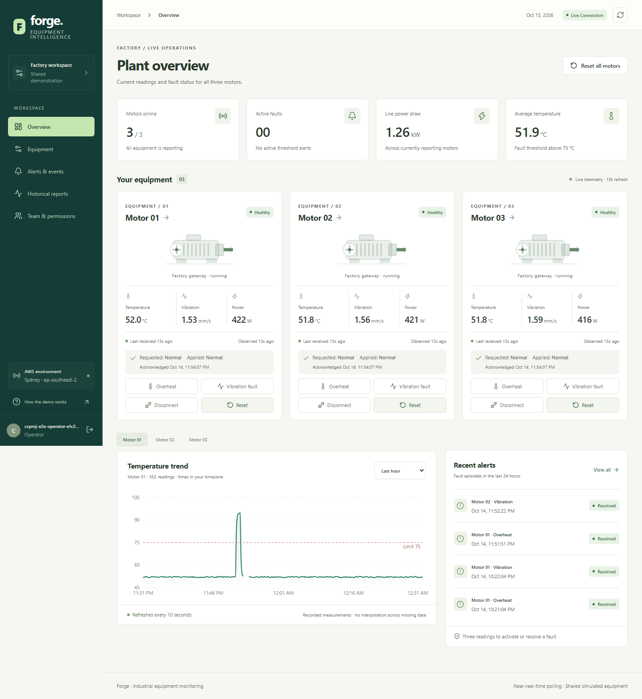
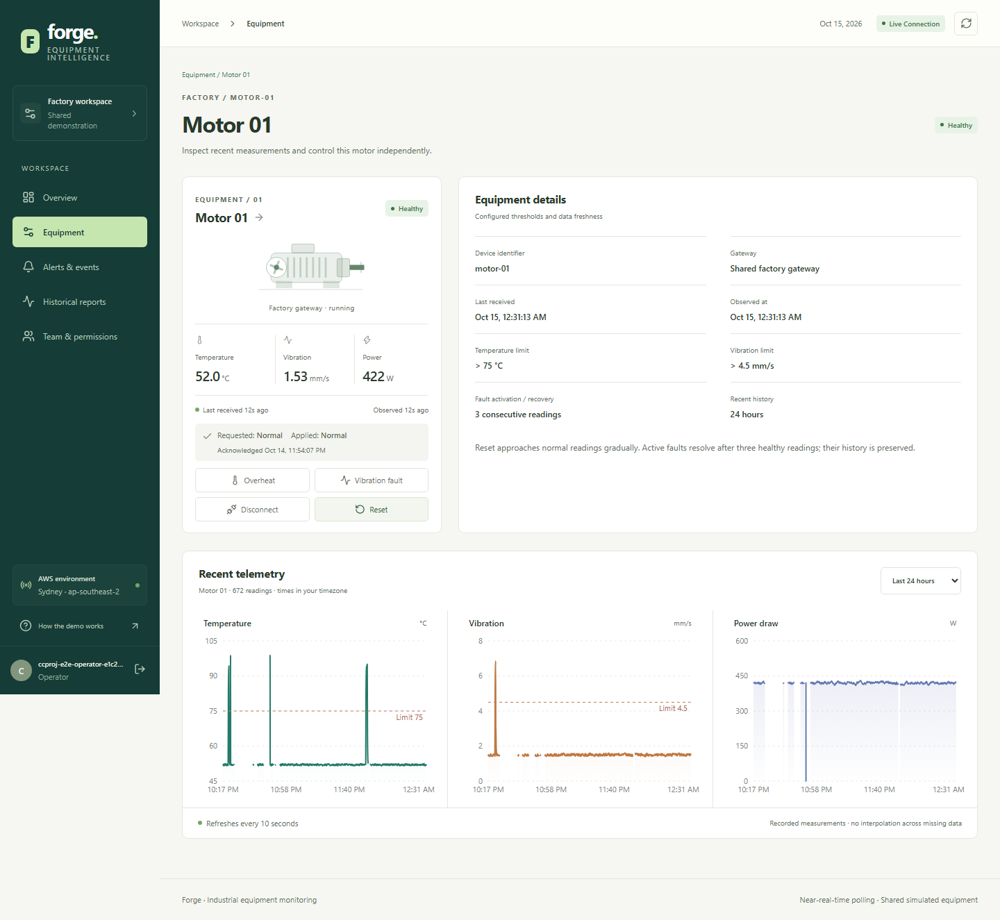
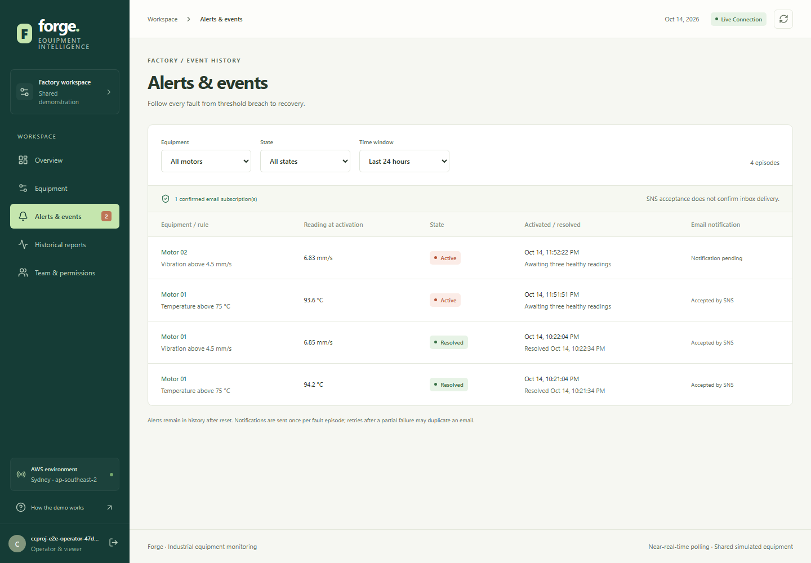
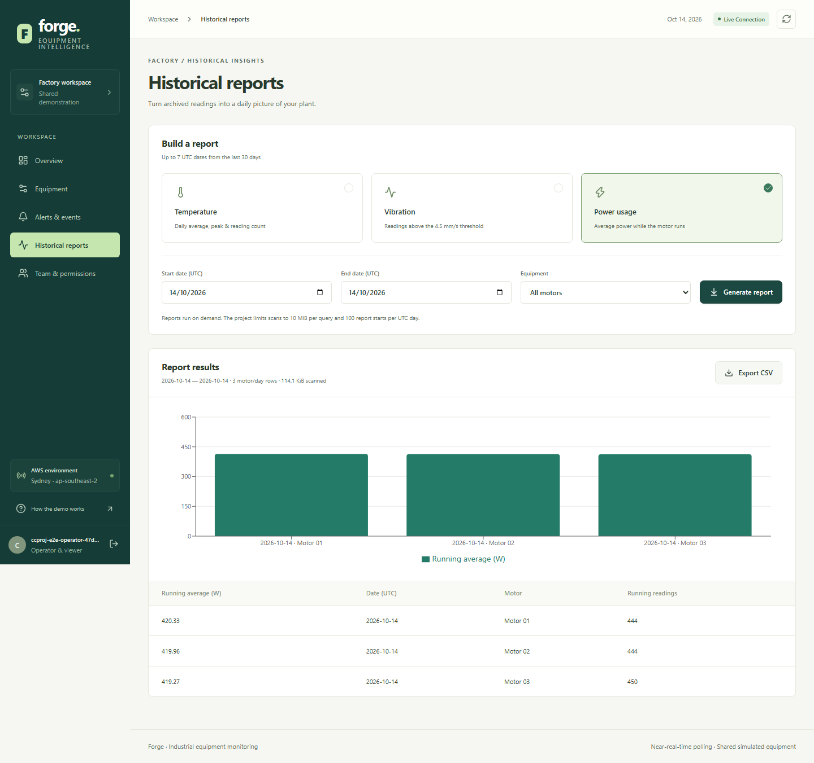
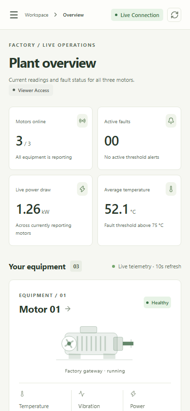
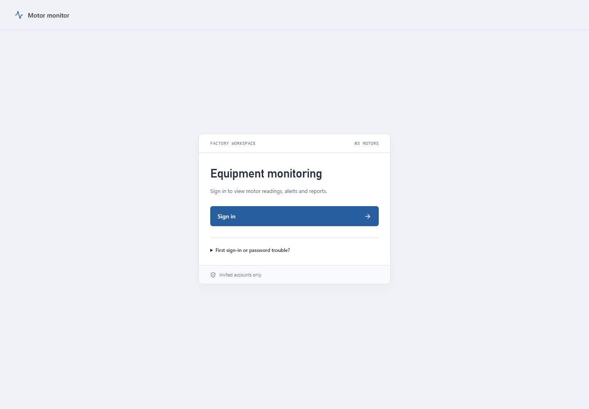

# Part 4. Verification evidence and screenshots

## 4.1 Evidence provenance

The submission packages existing implementation records, rather than running another disruptive acceptance exercise. AWS-stage evidence is dated 14 October 2026; the entry-page refinement, final UI evidence and account diagnostics extend into 15 October in India. Machine timestamps in JSON/XML may use UTC. Relative links below work from the repository; copies of the compact summaries are included under `evidence/` for convenient submission.

| Evidence | What to inspect | Location |
| --- | --- | --- |
| AWS acceptance summary | Fourteen distinct scenario names, status, source run and measurements | [Copied JSON](evidence/live-acceptance.json), [original XML](../docs/live-acceptance.xml) |
| UI acceptance summary | Twenty-three controlled cases, four earlier deployed journeys, later smoke and release hashes | [Copied JSON](evidence/ui-acceptance.json) |
| Full deployed browser run | Four journey count and real run outcome, including setup/cleanup | [Original XML](../docs/ui-live-acceptance.xml) |
| Final published smoke | Real desktop/mobile hosted-login and live chart result | [Copied JSON](evidence/ui-live-smoke.json), [original XML](../docs/ui-live-smoke.xml) |
| Deployed health/config snapshot | Three motor states, mapping/queues, alarms, private storage, retention and budgets at capture | [Copied JSON](evidence/deployed-evidence.json) |
| Fault notifications | Stored SNS acceptance records; human receipt is separately reported in acceptance notes | [Copied JSON](evidence/notification-evidence.json) |
| Historical cost model | Inputs, estimated component amounts and explicit assumptions | [Copied JSON](evidence/budget-model.json), [pricing snapshot](../docs/pricing-snapshot.json) |
| Deployment outputs | CloudFormation outputs and deployed logical-to-physical resources | [Original JSON](../docs/ccproj-deployment.json) |
| Account access exception | Latest unresolved first-password/recovery diagnostic and investigation boundary | [Current handoff](../PROGRESS.md) |
| Operator command audit | Timestamp, purpose, non-secret command arguments and exit status | [AWS_COMMANDS.txt](../AWS_COMMANDS.txt) |
| Future cleanup | Ordered shutdown and retained-resource handling; live teardown not run | [SHUTDOWN.md](../docs/SHUTDOWN.md) |

The copied `ui-acceptance.json` contains an earlier invitation-recovery note. The later unresolved password report and last diagnostic in `PROGRESS.md` supersede any implication that the user's sign-in is complete. The document-build manifest hashes the source documents, generated artifacts and selected evidence; it establishes file integrity, not the correctness of an AWS service outside the recorded run.

## 4.2 Scenario coverage

Backend checks include strict input validation, rule boundaries/counters, retry-safe archive/transactions, duplicate and old events, controls, authorization, report bounds/SQL, command-audit restrictions and infrastructure invariants. Moto-backed integration tests exercise handler interactions in a controlled environment; they are distinct from real AWS scenarios.

The fourteen live AWS scenarios cover healthy EC2 operation and fault recovery; signed invalid ingestion; deduplication, ordering and archive; consumer interruption/catch-up; poison-message DLQ and corrected redrive; real tokens, roles and hosted PKCE; user management/revocation; bounded burst and stopped reporting; confirmed notification acceptance/retry suppression; bounded Athena/private hosting; known-data report calculations; cache hit/update invalidation; and limited object/table recovery.

Controlled Playwright cases cover failure and rare states reproducibly, including expired sessions, failed renewal, bad OAuth state, retained stale responses, timed-out controls, offline/stopped differences, report empty/error outcomes, role/self-protection, accessible controls and mobile overflow. The real browser journeys use the deployed Cognito/API and actual measurements, with disposable test accounts removed afterward. Invitations are suppressed for disposable live accounts; controlled invitation UI tests avoid sending unsolicited mail.

Recorded AWS-stage latency was 5.063 seconds from signed ingestion to current state, including polling. The limited recovery measured 70.641 seconds before verification/cleanup. No percentile performance claim, production load ceiling, full-regional recovery objective or universal functionality guarantee is inferred from those samples.

## 4.3 Selected visual evidence

The overview, detail, alerts, reports and mobile overview below were captured from the deployed application during real browser testing. Visible users are disposable test accounts and history contains deliberate test faults/readings. They demonstrate the interface and tested data, not uninterrupted normal industrial operation. Login images show the later revised entry layout captured by controlled browser tests; they do not show credentials or a successful initial-account password setup.

### Screenshot A. Desktop motor overview

### Screenshot B. Recent temperature, vibration and power

### Screenshot C. Active and resolved fault history

### Screenshot D. Historical report results

### Screenshot E. Mobile viewer layout

The top viewport is shown for print legibility. The unchanged [full-page mobile capture](assets/ui-overview-mobile.png) is also supplied.

### Screenshot F. Revised concise entry page

## 4.4 Demonstration sequence for an evaluator

1. Resolve the initial-account password issue, then sign in with an authorized evaluator account. Explain the distinct viewer/operator roles.
2. Show three normally reporting motors, freshness timestamps and recent charts. Explain that the gateway produces synthetic readings.
3. Request overheat on one motor. Show pending then applied acknowledgement, gradual measurement change and an active alert after three breached readings. Observe that the other motors continue normally.
4. Show retained alert history and the recorded confirmed-email evidence. Do not equate a new `sns_accepted` label with verified inbox delivery.
5. Reset the motor and observe recovery/three healthy readings. Demonstrate disconnect versus a stopped-but-reporting reading using the existing test evidence if another live fault is unnecessary.
6. Run one bounded historical report and explain date projection, deduplication and scan bounds. Use the saved known-data test result to support calculation correctness.
7. Show the queue-interruption/DLQ/recovery evidence and CloudFormation source. A new live failure injection is optional and must follow the safe test procedures.
8. Present the estimate versus actual-spend distinction, current acceptance exception, command audit and future shutdown procedure. Leave the project online under the existing instruction.

## 4.5 Submission readiness record

Requirements, implemented design, tooling inventory, architecture diagrams, selected UI evidence and reproducibility references are provided. Source and evidence have been committed incrementally. This report does not mark the initial account's first access as resolved and does not invent a final actual cost. Those are explicit follow-up acceptance items.
